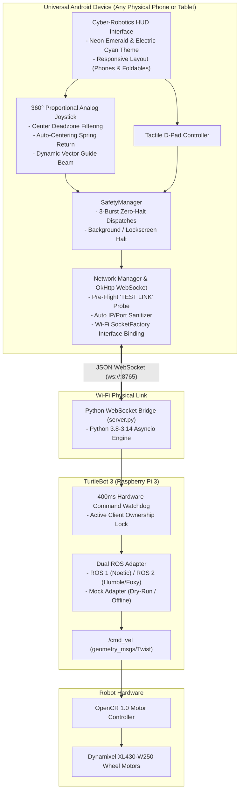
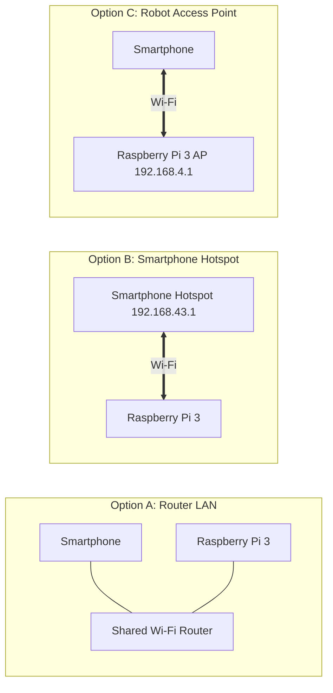

# 🤖 Mob_contoller

<div align="center">

[-3DDC84?style=for-the-badge&logo=android&logoColor=white)](https://developer.android.com)
[](https://kotlinlang.org)
[](https://python.org)
[](https://ros.org)
[-success?style=for-the-badge&logo=checkmarx&logoColor=white)](TurtleBotController)
[](LICENSE)

### Universal Smartphone Robot Controller & WebSocket Bridge for TurtleBot 3
**A modern, production-grade teleoperation, safety monitoring, and diagnostics suite engineered for TurtleBot 3 Burger and Waffle mobile robots.**

*Operates reliably on any physical Android smartphone or tablet across all aspect ratios (16:9 to 21:9 foldables) and communicates with Raspberry Pi 3/4/5 over local Wi-Fi.*

</div>

---

## 📑 Table of Contents

- [Overview & Key Features](#-overview--key-features)
- [System Architecture](#-system-architecture)
- [Hardware & Software Requirements](#-hardware--software-requirements)
- [Android App Installation](#-android-app-installation)
- [Raspberry Pi Bridge Installation](#-raspberry-pi-bridge-installation)
- [Auto-Start Bridge on Boot (Systemd)](#-auto-start-bridge-on-boot-systemd)
- [Network Connection Topologies](#-network-connection-topologies)
- [WebSocket Protocol Specification](#-websocket-protocol-specification)
- ["Zero-Harm" Safety Architecture](#-zero-harm-safety-architecture)
- [Troubleshooting & Diagnostics Matrix](#-troubleshooting--diagnostics-matrix)
- [Automated Testing & Verification](#-automated-testing--verification)
- [Repository Structure](#-repository-structure)
- [License](#-license)

---

## 🌟 Overview & Key Features

### 🎮 Cyber-Robotics Glassmorphism HUD
- **Ergonomic Operator Interface**: Sleek dark theme with neon emerald (`#00FF88`), electric cyan (`#00E5FF`), and pulsing hazard indicators designed for high-contrast field operations.
- **360° Proportional Virtual Joystick**: Continuous velocity control with deadzone filtering, visual range rings (25%, 50%, 75%), dynamic vector guide beam, and live power percentage readout.
- **Tactile D-Pad Mode**: Discrete directional touch controls for precision docking, tight corridor maneuvering, and delicate inspection tasks.
- **One-Tap Speed Presets**: Instant throttle governors:
  - **ECO** (`0.04 m/s` • `0.30 rad/s`) — Precision alignment and battery saving.
  - **NORMAL** (`0.08 m/s` • `0.50 rad/s`) — Standard indoor lab navigation.
  - **SPORT** (`0.15 m/s` • `1.20 rad/s`) — Rapid transit and outdoor exploration.

### 📡 Bulletproof Physical Connection Pipeline
- **Pre-Flight "TEST LINK" Diagnostic**: One-tap TCP ping probe inside app settings to verify network latency and Raspberry Pi reachability before initiating a full WebSocket handshake.
- **Cellular Data Bypass via Wi-Fi Interface Binding**: Binds all socket traffic to Android's physical Wi-Fi network interface for private subnets (`192.168.x.x`, `10.x.x.x`, `172.x.x.x`), preventing modern smartphones from misrouting local packets through 4G/5G when the robot Wi-Fi has no internet.
- **Universal Host & Port Sanitizer**: Automatically cleans user input, stripping `ws://`, `http://`, trailing slashes, misplaced ports, and accidental spaces.
- **10 Hz Real-Time Bi-Directional Telemetry**: Continuous streaming of live linear velocity, angular velocity, OpenCR battery voltage, link latency, and packet loss counters.

### 🛡️ Multi-Tiered Safety Defenses
- **Dead-Man Auto-Centering Spring**: Releasing your thumb instantly dispatches an immediate zero-velocity halt in $< 16\text{ms}$.
- **3-Burst Zero-Halt Dispatches**: Every release, screen lock, or disconnect triggers 3 consecutive zero-velocity commands over TCP to ensure packet delivery even across jittery Wi-Fi.
- **400ms Fail-Safe Hardware Watchdog**: The Raspberry Pi bridge cuts motor velocities to absolute zero if no valid command packet is received within 400 milliseconds.
- **Physical Emergency Stop (E-STOP)**: Prominent glowing safety button halts all motion and engages software brakes until explicitly released by the operator.
- **Hardware Kinematic Caps**: Hard velocity limits enforced by the Python bridge (`0.22 m/s` linear, `2.84 rad/s` angular) prevent motor stalling, gear stripping, and chassis tip-over.

---

## 🚀 System Architecture



---

## 🔧 Hardware & Software Requirements

| Component | Specification | Supported Range |
|---|---|---|
| **Mobile Device** | Any Android smartphone or tablet | Android 8.0 (API 26) through Android 14/15/16 |
| **Robot Base** | TurtleBot 3 Burger or TurtleBot 3 Waffle / Waffle Pi | Official ROBOTIS hardware |
| **SBC** | Raspberry Pi 3 Model B+, Raspberry Pi 4B, or Raspberry Pi 5 | Raspberry Pi OS (Bullseye / Bookworm) |
| **Microcontroller** | OpenCR 1.0 (ARM Cortex-M7) | Firmware v1.0+ via `/dev/ttyACM0` |
| **Actuators** | 2x Dynamixel XL430-W250-T smart servos | Standard differential drive setup |
| **Battery** | 11.1V 1800mAh 3S LiPo battery | Monitored live via OpenCR ADC |
| **ROS Distro** | ROS 1 (Noetic) or ROS 2 (Humble / Foxy / Iron) | Auto-detected by `inspect_robot.py` |

---

## 📱 Android App Installation

### Option 1: Direct APK Installation via ADB (Fastest)
Connect your Android smartphone to your PC via USB with **USB Debugging** enabled:
```powershell
# Navigate to the Android project directory
cd TurtleBotController

# Build the release or debug APK
.\gradlew.bat assembleDebug

# Stream-install directly to your phone
adb install -r app\build\outputs\apk\debug\app-debug.apk

# Launch the app on your phone
adb shell am start -n com.turtlebot.controller.debug/com.turtlebot.controller.MainActivity
```

### Option 2: Open and Run in Android Studio
1. Launch Android Studio.
2. Click **File** > **Open** and select the [`TurtleBotController/`](TurtleBotController/) directory.
3. Allow Gradle to download dependencies and sync.
4. Select your connected physical smartphone from the device target dropdown.
5. Click **Run 'app'** (`Shift + F10`).

---

## 🤖 Raspberry Pi Bridge Installation

### Step 1: Install Dependencies
Open a terminal on your Raspberry Pi:
```bash
# Clone the repository (if not already cloned)
git clone https://github.com/praujwalstudio/Mob_contoller.git
cd Mob_contoller/turtlebot_bridge

# Install required Python packages
pip3 install -r requirements.txt
```

### Step 2: Run Hardware & Network Pre-Flight Check
Run the zero-dependency diagnostic inspector to verify all drivers and ports:
```bash
python3 inspect_robot.py
```
*Expected output: detected OS, active ROS distribution, OpenCR serial device (`/dev/ttyACM0`), assigned IP addresses, and WebSocket port availability.*

### Step 3: Start the Bridge Server
```bash
# For physical TurtleBot 3 with ROS active:
python3 server.py --host 0.0.0.0 --port 8765

# For dry-run simulation / testing on a PC without ROS:
python3 mock_bridge.py --host 0.0.0.0 --port 8765
```

---

## ⚙️ Auto-Start Bridge on Boot (Systemd)

To make the WebSocket bridge launch automatically whenever the Raspberry Pi powers on:

1. Create a systemd service file:
```bash
sudo nano /etc/systemd/system/turtlebot_bridge.service
```

2. Paste the following configuration (replace `pi` with your username if different):
```ini
[Unit]
Description=TurtleBot 3 WebSocket Bridge Service
After=network.target

[Service]
Type=simple
User=pi
WorkingDirectory=/home/pi/Mob_contoller/turtlebot_bridge
ExecStart=/usr/bin/python3 /home/pi/Mob_contoller/turtlebot_bridge/server.py --host 0.0.0.0 --port 8765
Restart=on-failure
RestartSec=3

[Install]
WantedBy=multi-user.target
```

3. Enable and start the service:
```bash
sudo systemctl daemon-reload
sudo systemctl enable turtlebot_bridge.service
sudo systemctl start turtlebot_bridge.service

# Verify service status:
sudo systemctl status turtlebot_bridge.service
```

---

## 🌐 Network Connection Topologies

The app and bridge provide three distinct connection models to accommodate laboratory, home, and field environments:



### Option A: Shared Home / Lab Wi-Fi Router (Recommended for Development)
1. Connect both your smartphone and Raspberry Pi to the exact same Wi-Fi router.
2. Run `hostname -I` on the Pi to check its assigned IP (e.g. `192.168.1.50`).
3. In the mobile app:
   - Go to the **Settings** tab.
   - Enter `192.168.1.50` (or tap the **ROUTER LAN** preset).
   - Tap **TEST LINK** to verify connection.
   - Tap **CONNECT**.

### Option B: Smartphone Wi-Fi Hotspot (Recommended for Field Operations)
1. Turn on your Android phone's **Personal Hotspot**.
2. Connect the Raspberry Pi's Wi-Fi to your phone's hotspot.
3. In the mobile app:
   - Go to the **Settings** tab.
   - Tap the **PHONE HOTSPOT** preset button (`192.168.43.1`).
   - Tap **CONNECT**.

### Option C: Robot Access Point (TurtleBot AP)
1. Configure the Raspberry Pi as a standalone Wi-Fi hotspot (e.g., `TurtleBot3_AP` with IP `192.168.4.1`).
2. Connect your smartphone's Wi-Fi to the robot network.
3. In the mobile app:
   - Go to the **Settings** tab.
   - Tap the **ROBOT AP** preset button (`192.168.4.1`).
   - Tap **CONNECT**.

---

## 📡 WebSocket Protocol Specification

All communication between the Android controller and the Raspberry Pi occurs over standard WebSocket frames using strict JSON schemas.

### Client to Server: Velocity Command (`cmd_vel`)
Sent continuously at 10–20 Hz while the operator is dragging the virtual joystick or holding a D-Pad button:
```json
{
  "type": "cmd_vel",
  "linear_x": 0.08,
  "angular_z": 0.50
}
```

### Client to Server: Immediate Stop (`stop`)
Sent upon thumb release or when switching modes:
```json
{
  "type": "stop"
}
```

### Client to Server: Emergency Stop (`emergency_stop`)
Dispatched immediately when the operator taps the red E-STOP button:
```json
{
  "type": "emergency_stop"
}
```

### Server to Client: Real-Time Telemetry (`telemetry`)
Streamed by the Raspberry Pi bridge at 10 Hz:
```json
{
  "type": "telemetry",
  "linear_velocity": 0.078,
  "angular_velocity": 0.492,
  "battery_voltage": 12.18,
  "is_emergency_stop": false,
  "state": "OPERATIONAL",
  "active_client": "192.168.1.100:48212",
  "timestamp": 1729318800.125
}
```

---

## 🛡️ "Zero-Harm" Safety Architecture

| Defense Layer | Trigger Condition | Safety Action | Recovery Requirement |
|---|---|---|---|
| **Thumb Release** | Operator lifts finger from joystick | Sends 3 consecutive zero-velocity bursts in $<16\text{ms}$. | Immediate resumption on touch. |
| **Hardware Watchdog** | Network packet loss exceeding 400ms | Raspberry Pi cuts motor command lease to zero. | Auto-recovers on next valid packet. |
| **App Lifecycle Watchdog** | Incoming phone call, lock screen, or app minimize | Android dispatches explicit halt; tears down active lease. | Requires reopening app. |
| **Emergency Stop (E-STOP)** | User taps E-STOP button | Latches motors in software brake; ignores further joystick input. | Manual operator unlock tap. |
| **Kinematic Clamping** | Over-range velocity command | Clamps linear speed to $\le 0.22\text{ m/s}$ and angular to $\le 2.84\text{ rad/s}$. | Automatic transparent clamping. |
| **Single-Client Lock** | Secondary smartphone attempts control | Server grants control to the first connected client; locks out others. | Primary client must disconnect first. |

---

## 🔍 Troubleshooting & Diagnostics Matrix

| Symptom | Probable Cause | Verified Resolution |
|---|---|---|
| **"TEST LINK reports unreachable"** | Phone and Pi are on different subnets, or Pi server is not running. | 1. Ensure phone Wi-Fi is on the exact same network as the Pi.<br>2. Run `python3 inspect_robot.py` on the Pi to check IP and verify port 8765 is open. |
| **"Connection drops immediately on 5G phone"** | Android cellular data bypass conflict. | The app automatically binds to the Wi-Fi interface. If your OS overrides this, briefly turn off Mobile Data in Android Quick Settings. |
| **"Address already in use: 8765"** | A previous bridge instance is still running in the background. | Run `sudo fuser -k 8765/tcp` or `sudo pkill -f server.py` on the Raspberry Pi, then restart the server. |
| **"OpenCR motor not moving"** | Serial permission denied on `/dev/ttyACM0`. | Grant USB dialout permissions: `sudo usermod -a -G dialout $USER`, then unplug and replug the OpenCR USB cable. |
| **"App shows LINK ERROR with crimson banner"** | Typo in IP address or port. | Use the pre-flight **TEST LINK** button to verify latency, and use the one-tap presets (**ROUTER LAN**, **HOTSPOT**, or **ROBOT AP**). |

---

## 🧪 Automated Testing & Verification

The entire repository has been verified with 30 passing automated tests covering all critical safety paths and protocol specifications.

### Running Android Unit Tests
```powershell
cd TurtleBotController
.\gradlew.bat test
```
*Tests executed (12/12 passing):*
- `JoystickKinematicsTest`: Deadzone filtering, polar-to-cartesian mapping, power scaling.
- `ProtocolSerializationTest`: JSON serialization, parsing, error recovery.
- `SafetyManagerTest`: 3-burst zero halt, emergency stop latching, lifecycle stops.

### Running Python Bridge Unit Tests
```bash
cd turtlebot_bridge
python -m unittest discover -s tests -p "test_*.py"
```
*Tests executed (18/18 passing):*
- `test_protocol.py`: Message schema validation, command bounds clamping.
- `test_safety.py`: 400ms command lease expiration, auto-stop on timeout.
- `test_server.py`: WebSocket connection lifecycle, multi-client ownership arbitration, disconnect halt.

---

## 📂 Repository Structure

```
Mob_contoller/
├── TurtleBotController/            # Android Mobile Application (Kotlin, Jetpack Compose)
│   ├── app/
│   │   ├── src/main/java/com/turtlebot/controller/
│   │   │   ├── data/               # Models, Repositories, WebSocket Client
│   │   │   │   ├── model/          # Command, Telemetry, and Connection state models
│   │   │   │   ├── network/        # RobotWebSocketClient (Wi-Fi bound OkHttp client)
│   │   │   │   └── repository/     # RobotRepository & SettingsRepository
│   │   │   ├── safety/             # Android SafetyManager (3-burst halt & watchdog)
│   │   │   ├── ui/                 # Cyber-Robotics UI theme, screens & components
│   │   │   │   ├── components/     # UniversalJoystick, D-Pad, E-Stop, TelemetryCard
│   │   │   │   ├── screens/        # MainControllerScreen, ConnectionSettingsScreen
│   │   │   │   └── theme/          # Color tokens, Typography, Glassmorphism styles
│   │   │   └── viewmodel/          # MainViewModel (State management & diagnostics)
│   │   └── build.gradle.kts        # Android build configuration (minSdk 26, targetSdk 34)
│   └── build.gradle.kts            # Project root buildscript
├── turtlebot_bridge/               # Raspberry Pi 3 WebSocket ROS Bridge (Python)
│   ├── server.py                   # Main WebSocket bridge server (asyncio engine)
│   ├── safety.py                   # 400ms hardware watchdog & active client lock
│   ├── ros_adapter.py              # Dual ROS 1 (rospy) / ROS 2 (rclpy) / Mock adapter
│   ├── inspect_robot.py            # Self-diagnostic hardware & network inspector
│   ├── mock_bridge.py              # Offline PC simulator for dry-run testing
│   ├── requirements.txt            # Python dependencies (websockets)
│   └── tests/                      # Python automated test suite
├── docs/                           # Comprehensive technical guides
│   ├── ROBOT_SETUP.md              # Physical Raspberry Pi & OpenCR wiring guide
│   ├── SAFETY_MANUAL.md            # Hardware thresholds & operational safety manual
│   ├── TROUBLESHOOTING.md          # Comprehensive network & driver resolution guide
│   └── WIFI_HOTSPOT_GUIDE.md       # Wi-Fi AP & Hotspot configuration tutorial
├── .gitignore                      # Git exclusion rules
└── README.md                       # Main project documentation & user manual
```

---

## 📄 License

This project is open-source under the [MIT License](LICENSE).  
Developed for the global robotics and ROS engineering community.