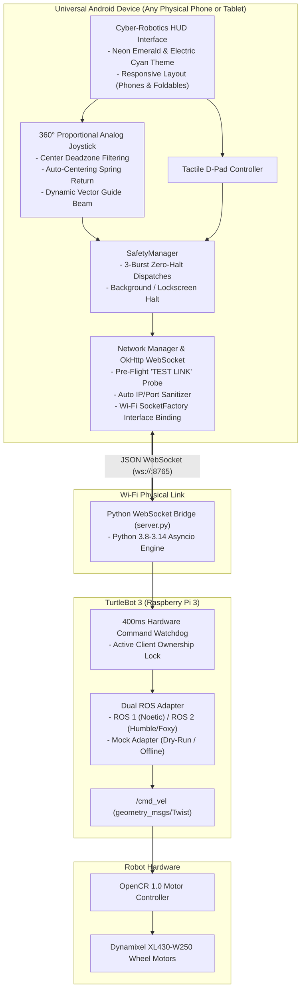
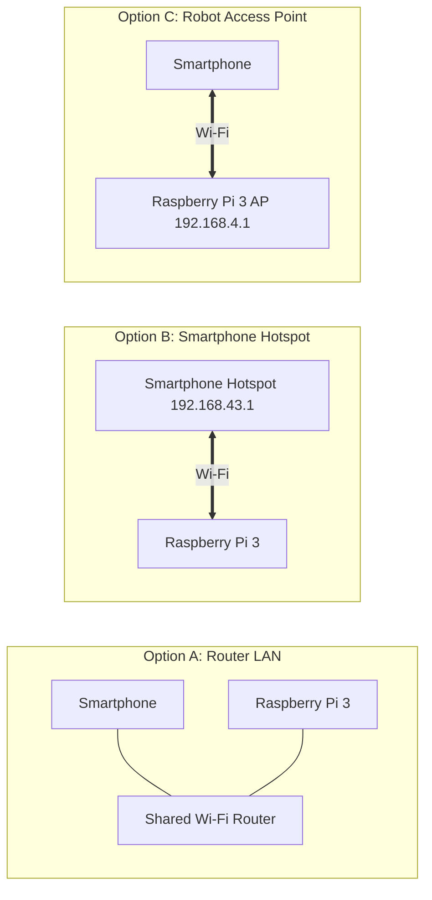

# Mob_contoller

> **Universal Smartphone Robot Controller & WebSocket Bridge for TurtleBot 3**  
> A production-grade, cyber-robotics teleoperation and real-time monitoring suite for **TurtleBot 3 Burger & Waffle** mobile robots. Built to run reliably on **any physical Android smartphone or tablet** (Android 8.0+ up to 14/15/16) and communicate seamlessly with **Raspberry Pi 3** over Wi-Fi.

---

## 🚀 System Architecture



---

## ✨ Key Features

- **Cyber-Robotics HUD Interface**: Glassmorphism styling with animated pulsing LED status badges, glowing hazard borders, and instant feedback.
- **360° Proportional Virtual Joystick**: Precision analog control with deadzone filtering, visual range rings (25%, 50%, 75%), and live power readout pills.
- **Dead-Man Auto-Centering Spring**: Releasing your thumb instantly dispatches an immediate zero-velocity halt in $< 16\text{ms}$.
- **Tactile D-Pad Mode**: Discrete directional touch pads for precision docking and tight corner maneuvering.
- **Pre-Flight "TEST LINK" Diagnostic**: One-tap TCP ping probe in the app settings to test network latency and Pi reachability before connecting.
- **Cellular Data Bypass**: Binds sockets to the physical Wi-Fi radio interface, preventing modern Android phones from misrouting local packets through 4G/5G.
- **Universal Input Sanitization**: Strips accidental prefixes (`ws://`, `http://`), ports, and trailing spaces automatically.
- **400ms Fail-Safe Hardware Watchdog**: The Raspberry Pi halts wheel motors if communication drops for 400ms.
- **Physical Emergency Stop (E-STOP)**: Immediate emergency latching halts all motion with 3 consecutive zero bursts.

---

## 📱 Quickstart: Android Application Setup

### Prerequisites
- Any Android phone or tablet running **Android 8.0 (API 26) or higher** (e.g. Vivo, Samsung, Pixel, OnePlus, Xiaomi).
- USB Debugging enabled on your smartphone (for direct ADB installation).

### Option 1: Install from Source via Android Studio
1. Open Android Studio and select **Open**.
2. Select the [`TurtleBotController`](TurtleBotController/) directory.
3. Allow Gradle to sync.
4. Connect your phone via USB and click **Run 'app'** (`Shift + F10`).

### Option 2: Build & Install via Command Line
```powershell
cd TurtleBotController

# Build the debug APK
.\gradlew.bat assembleDebug

# Install directly to your connected phone
adb install -r app\build\outputs\apk\debug\app-debug.apk
```

---

## 🤖 Quickstart: Raspberry Pi 3 Bridge Setup

### Prerequisites
- Raspberry Pi 3 (or 4/5) running Raspberry Pi OS (Bullseye or Bookworm).
- Python 3.8 to 3.14.
- Python dependencies: `websockets`.

### Step 1: Install Dependencies
```bash
cd turtlebot_bridge
pip3 install -r requirements.txt
```

### Step 2: Inspect Hardware & Network
Run the self-diagnostic environment inspector:
```bash
python3 inspect_robot.py
```
This prints your detected Linux OS, active ROS distribution, OpenCR USB serial port, and assigned IP addresses.

### Step 3: Launch the Bridge Server
```bash
# On physical TurtleBot 3 with ROS:
python3 server.py --host 0.0.0.0 --port 8765

# For offline testing / simulation on PC:
python3 mock_bridge.py --host 0.0.0.0 --port 8765
```

---

## 🌐 Connection Topologies

The app and bridge support all 3 physical networking modes:



### Option A: Shared Home / Lab Wi-Fi Router (Recommended for Development)
1. Connect both your smartphone and Raspberry Pi to the same Wi-Fi router.
2. Run `hostname -I` on the Pi to get its IP address (e.g. `192.168.1.50`).
3. In the mobile app **Settings** tab:
   - Enter `192.168.1.50` (or tap **ROUTER LAN**).
   - Tap **TEST LINK** to verify connection.
   - Tap **CONNECT**.

### Option B: Smartphone Wi-Fi Hotspot (Recommended for Field Operations)
1. Turn on your Android phone's **Personal Hotspot**.
2. Connect the Raspberry Pi to your phone's hotspot Wi-Fi.
3. In the mobile app **Settings** tab:
   - Tap the **PHONE HOTSPOT** preset button (`192.168.43.1`).
   - Tap **CONNECT**.

### Option C: Robot Access Point (TurtleBot AP)
1. Enable Wi-Fi AP on the Raspberry Pi (e.g. `TurtleBot3_AP` at `192.168.4.1`).
2. Connect your phone's Wi-Fi directly to the robot.
3. In the mobile app **Settings** tab:
   - Tap the **ROBOT AP** preset button (`192.168.4.1`).
   - Tap **CONNECT**.

---

## 🛡️ "Zero-Harm" Safety Architecture

| Layer | Mechanism | Safety Action |
|---|---|---|
| **App Watchdog** | Screen lock / App minimize | Dispatches immediate 3-burst zero halt commands. |
| **Thumb Release** | Dead-man spring return | Halts robot motion in $< 16\text{ms}$. |
| **Pi Watchdog** | 400ms command lease | Motors cut to zero if communication packets stall. |
| **Kinematic Caps** | Physical limits | Linear speed clamped at `0.22 m/s`, Angular turn rate at `2.84 rad/s`. |
| **Client Lock** | Single-operator mutual exclusion | Rejects conflicting commands from secondary devices. |
| **E-STOP** | Hardware software brake | Locks robot in hard stop until manual operator unlock. |

---

## 🧪 Testing & Verification

### Running Automated Android Tests
```powershell
cd TurtleBotController
.\gradlew.bat test
```
*Executes all 12 unit tests (Protocol Serialization, Kinematics, SafetyManager).*

### Running Automated Python Bridge Tests
```bash
cd turtlebot_bridge
python -m unittest discover -s tests -p "test_*.py"
```
*Executes all 18 bridge tests (Watchdog timeout, Client lock, Command clamping, Disconnect halt).*

---

## 📂 Project Structure

```
Mob_contoller/
├── TurtleBotController/            # Android Application (Kotlin, Jetpack Compose, OkHttp)
│   ├── app/src/main/java/com/turtlebot/controller/
│   │   ├── data/                   # Models, Repositories, WebSocket Client
│   │   ├── safety/                 # Android SafetyManager & Watchdog
│   │   ├── ui/                     # Cyber-Robotics Theme, Screens & Components
│   │   └── viewmodel/              # State management & connection orchestration
│   └── build.gradle.kts            # Android Gradle configuration
├── turtlebot_bridge/               # Raspberry Pi WebSocket Bridge (Python)
│   ├── server.py                   # Main WebSocket server (asyncio engine)
│   ├── safety.py                   # 400ms hardware watchdog & lease manager
│   ├── ros_adapter.py              # Dual ROS 1 / ROS 2 / Mock bridge
│   ├── inspect_robot.py            # Hardware & network environment diagnostic tool
│   ├── mock_bridge.py              # Standalone PC offline test server
│   └── tests/                      # Python automated test suite
├── docs/                           # Technical documentation & guides
│   ├── ROBOT_SETUP.md              # Raspberry Pi & OpenCR physical setup
│   ├── SAFETY_MANUAL.md            # Hardware safety thresholds & operational rules
│   ├── TROUBLESHOOTING.md          # Network & driver resolution guide
│   └── WIFI_HOTSPOT_GUIDE.md       # AP configuration walkthrough
├── .gitignore                      # Git exclusion rules
└── README.md                       # Main project documentation
```

---

## 📄 License
MIT License. Developed for the global robotics and ROS engineering community.
